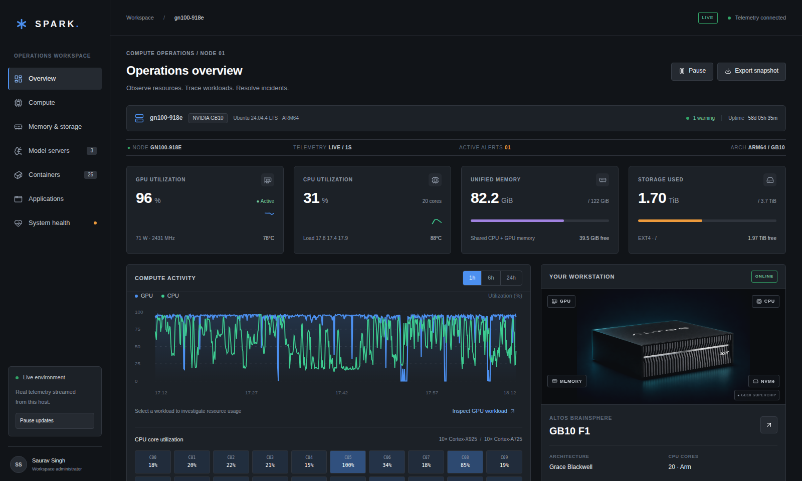
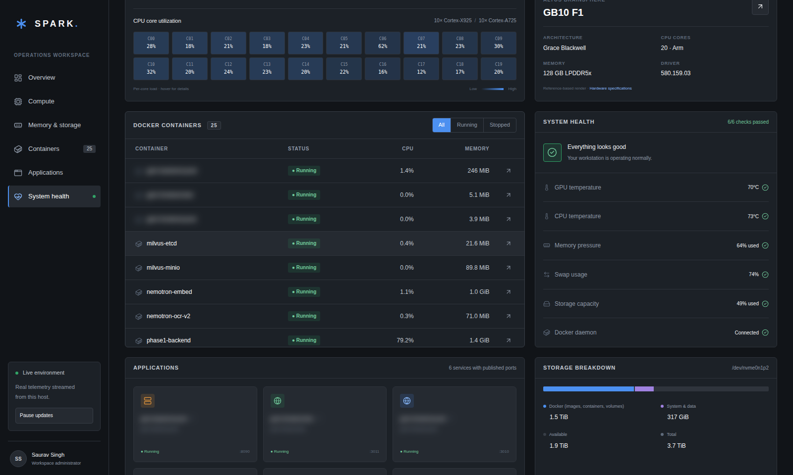
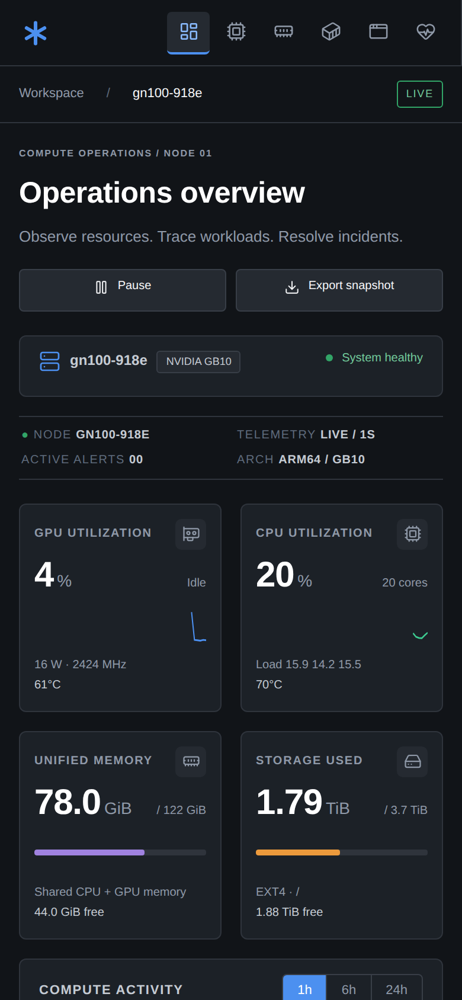
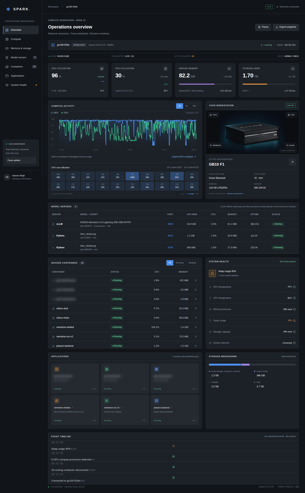
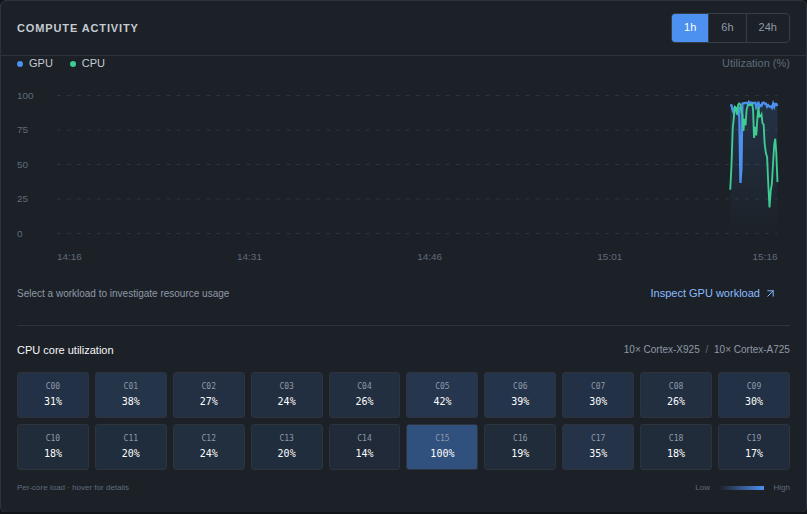
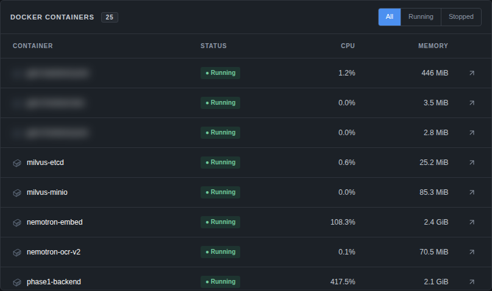
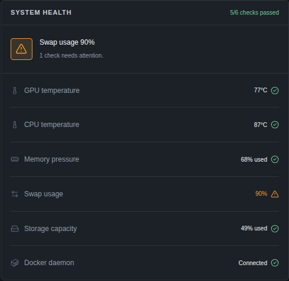
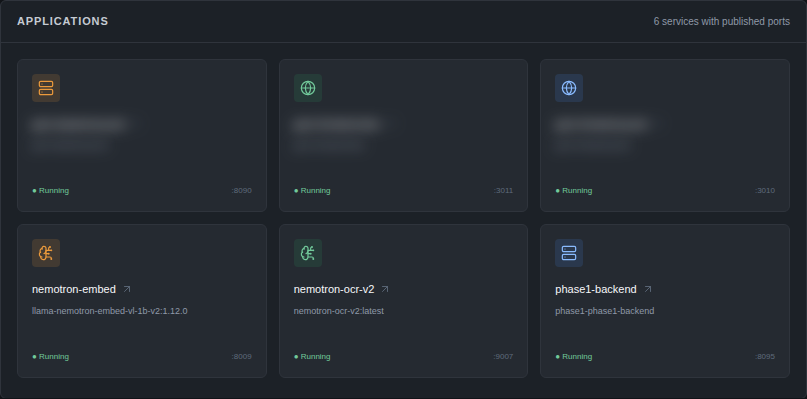
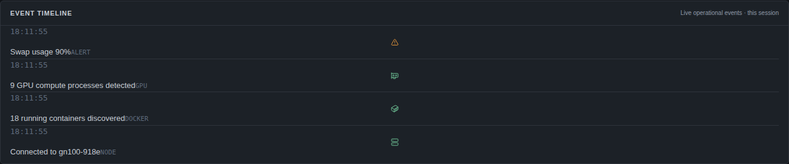

# Spark Dash

A live monitoring console for an NVIDIA **GB10 / DGX Spark–class** Linux workstation (aarch64, unified memory). It shows Docker containers, GPU utilization, CPU and per-core load, memory, disk, processes and system health in a dark, Palantir/Blueprint-style UI with animated metrics. It runs in a browser or as a packaged Linux desktop app.



## Features

- **GPU** – utilization, temperature, power and clocks via `nvidia-smi`; per-process GPU memory (GB10 reports no dedicated VRAM, so GPU memory is the sum of compute-process usage).
- **CPU** – total load plus a live per-core grid (20 Arm cores: 10× Cortex-X925 + 10× Cortex-A725), temperature and load average.
- **Memory and storage** – unified memory, swap, NVMe usage and a Docker storage breakdown (units in GiB/TiB).
- **Model servers** – detects LLM servers that run directly on the host, outside Docker (vLLM, Ollama, llama.cpp, SGLang, TGI, Triton, TensorRT-LLM, LMDeploy, MLC, KoboldCpp, LocalAI, ComfyUI) plus any other Python process using the GPU. Shows model name (read from the server's API or command line), port, GPU memory, CPU, memory, uptime and API health.
- **Docker** – every container with status, CPU and memory; click one for details.
- **Compute history** – 1h / 6h / 24h charts with hover crosshair; ring buffers kept server-side.
- **System health** – six live checks (GPU/CPU temperature, memory, swap, disk, Docker) with an event timeline of changes.
- **Realtime** – a server-side sampler streams snapshots over Server-Sent Events (1 s tick).
- **Desktop app** – Electron wrapper producing an AppImage and `.deb` for arm64.

| Container details | Mobile |
|---|---|
|  |  |



## Screenshots

**Compute activity and per-core load**



**Docker containers**



**System health**



**Applications and storage**



**Event timeline**



## Requirements

- Linux (developed on Ubuntu 24.04, arm64)
- Node.js 20+ (built with 22)
- `nvidia-smi` for GPU data (optional; the GPU panels show as unavailable without it)
- Docker, with your user in the `docker` group, for the container panels:
  `sudo usermod -aG docker $USER` then log out and in

## Run in the browser

```bash
npm install
npm run dev            # development, http://localhost:3000
# or
npm run build
npm start              # production, listens on 0.0.0.0:3000
```

To reach it from another machine on your network, allow the port, for example:

```bash
sudo ufw allow from 192.168.1.0/24 to any port 3000 proto tcp
```

Rebuilding (`npm run build`) while `npm start` is running breaks the running server; restart it afterwards.

## Build the desktop app

```bash
npm run app:build      # outputs to dist-app/ (AppImage and .deb, arm64)
sudo apt install ./dist-app/spark-dash_0.1.0_arm64.deb
```

For a quick try without packaging: `npm run app:dev`.

Notes:
- The app bundles the Next.js standalone server and starts it on a random localhost port.
- GPU hardware acceleration is disabled in Electron because the GPU process crashes on this ARM/NVIDIA stack.
- Chromium refuses to run as root; launch as a normal user (or pass `--no-sandbox`).
- The `.deb` ships an AppArmor profile for Ubuntu 24.04's user-namespace restriction.

## How it works

| Path | Purpose |
|---|---|
| `lib/sampler.ts` | Singleton sampler reading `/proc`, thermal zones, `df`, `nvidia-smi`, `docker`; model-server detection (process scan + `ss` + engine APIs); history ring buffers |
| `instrumentation.ts` | Starts the sampler when the server boots |
| `app/api/stream/route.ts` | SSE stream of live snapshots |
| `app/api/history/route.ts` | History for the 1h / 6h / 24h charts |
| `components/Dashboard.tsx` | The UI |
| `electron/main.cjs` | Desktop shell |
| `scripts/prepare-app.mjs` | Prepares the standalone server for packaging |

Built with Next.js 16 (App Router), React 19, `motion` and `lucide-react`.

## Known limitations

- History lives in server memory and resets when the server restarts.
- GPU memory on GB10 is an estimate (see above).
- `docker system df` can take several minutes, so the Docker storage figure refreshes every 10 minutes.
